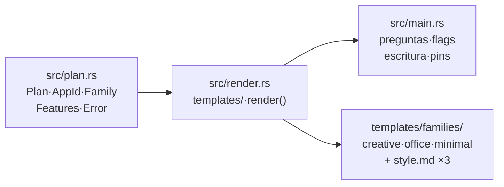

# Plan: `craft-scaffold` slices (`ready-for-agent`)

File structure first (`crates/scaffold/`):

Each slice is tracer-bullet (all layers it touches, demoable in one window),
S/M size (≤5 files). Checkpoints every 2–3 slices.

## Slice 1 — `plan-rs` (no Blocked-by)

- Files: `crates/scaffold/Cargo.toml`, `src/plan.rs`, tests in-module.
- Acceptance: `Plan` validates `AppId` (`[_a-z0-9-]` nonempty, else
  `INVALID_APP_ID`); `Family::parse` accepts exactly
  `creative|office|minimal`; `--out` non-empty rejection is representable
  (`OUTPUT_NOT_EMPTY`); `ScaffoldError` codes stable strings.
- Verification: `cargo test -p craft-scaffold plan_` → all pass.
- `Expected:` 6+ unit tests (valid/invalid ids, family parse, error codes).

## Slice 2 — `render-minimal` (Blocked-by: slice 1)

- Files: `src/render.rs` (`render()`, `OutputFile`), `templates/families/minimal/*`
  (Cargo.toml, main.rs, settings.rs, app.rs, icons.rs, style.md, AGENTS.md),
  `no_placeholders_left` test.
- Acceptance: `render(&Plan{minimal})` returns 7 files, zero `{{` leftovers,
  `APP_ID`/`display-name` substituted everywhere; menu+status shell with
  `panel_frame` + `icon_slot` from shell-common.
- Verification: `cargo test -p craft-scaffold render_minimal no_placeholders_left`.
- `Expected:` generated `Cargo.toml` contains the app id; `grep -r '{{'`
  over output = empty.

## Slice 3 — `cli-writes-disk` (Blocked-by: slice 2)

- Files: `src/main.rs` (interactive 4 questions + `--no-interactive` flags +
  disk write + path-deps→git-pins rewrite outside repo).
- Acceptance: `--no-interactive --app-id myapp --family minimal --out <empty>`
  creates the folder; re-run on same dir fails `OUTPUT_NOT_EMPTY`; `--out`
  outside repo rewrites `path = "../../crates/*"` to git pins;
  `--help` lists all flags.
- Verification: `cargo test -p craft-scaffold cli_` (tempdirs) +
  manual `cargo run -p craft-scaffold -- --help`.
- `Expected:` 4 CLI tests (happy path, non-empty refusal, pins rewrite,
  invalid family message).

## Slice 4 — `shell-creative` (Blocked-by: slice 2)

- Files: `templates/families/creative/*` (app-bar 32pt, rail 48pt/30pt pitch,
  canvas PROTECTED + pasteboard, Layers/Properties/History, status 24pt,
  16-field Tokens ×4, 14-icon catalog, style.md).
- Acceptance: `render(&Plan{creative})` passes `no_placeholders_left`;
  `icon_slot` = square centered + `fit_to_exact_size`; bodies wrapped in
  `panel_frame(Margin{12,10,10,8})`; canvas `Permissions::PROTECTED`.
- Verification: `cargo test -p craft-scaffold render_creative` +
  `cargo check` on generated creative output (warm).
- `Expected:` check exit 0, zero warnings.

## Slice 5 — `shell-office` (Blocked-by: slice 2)

- Files: `templates/families/office/*` (title-bar 38pt, tabs,
  ribbon `RIBBON_H=66` collapsible with big/small buttons + groups + overflow
  via `fit_toolbar`, document + panes, status 26pt, style.md).
- Acceptance: same as slice 4 + ribbon collapses to 32pt strip;
  `fit_toolbar` overflow reachable through an enabled control.
- Verification: `cargo test -p craft-scaffold render_office` +
  `cargo check` on generated office output (warm).
- `Expected:` check exit 0, zero warnings.

## Slice 6 — `golden-harness` (Blocked-by: slices 4, 5)

- Files: generated `tests/shell_golden.rs` template (all families) +
  `docs/style.md` local-generation instructions.
- Acceptance: harness renders full shell offscreen (`egui_kittest+wgpu`) at
  2 widths × 2 scales, writes `-before/-after/-difference.png` +
  `comparison.tsv` to `$SHELL_GOLDEN_DIR`; fails cleanly without renderer.
- Verification: run harness in one generated app per family, confirm PNGs +
  TSV appear and a deliberate 1px color edit fails the comparison.
- `Expected:` 3 harness runs green; negative edit red.

## Slice 7 — `generation-compiles` (Blocked-by: slices 3, 4, 5, 6)

- Files: `tests/generation.rs` (ignored-by-default → required in CI).
- Acceptance: generates all 3 families to tempdirs via the built CLI binary
  and `cargo check`s each; asserts `fmt --check`, `clippy -D warnings` clean.
- Verification: `cargo test -p craft-scaffold -- --ignored generation_`
  fully green (network, warm target dir).
- `Expected:` 3/3 families check-clean; this is the F4→F5 gate test.
