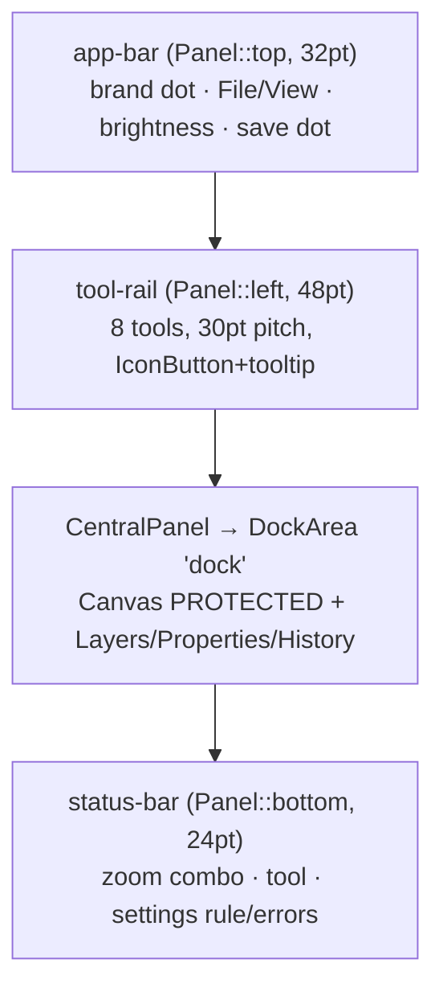

# Desktop egui starter (`templates/desktop-egui`)

Copy-paste starter for a cross-platform desktop app with Rust + [eframe]/[egui],
wired to craft-libs from the first frame. **Template, not a library: copy this
folder out, never add it as a dependency.** It is intentionally *not* a
craft-libs workspace member, so the parent `cargo test --workspace` ignores it.

The shell looks like a Craft app on first run: 32 pt app bar, 48 pt tool rail,
document canvas on a pasteboard, right dock (Layers / Properties / History),
24 pt status bar — MediumDark with the `#378ef0` accent. Composition follows
VectorCraft (`chrome.rs` app bar + `toolbar.rs` rail + `dock.rs` right group +
status bar); colors follow its `Tokens` scale.

Copy and rename (5 identifiers — nothing else is required):

```sh
cp -r templates/desktop-egui ~/my-app && cd ~/my-app
grep -rn "template-app\|Template App\|TemplateApp" --include="*.rs" --include="*.toml" . | cut -d: -f1 | sort -u
```

| Find | Replace with | Effect |
|---|---|---|
| `template-app` (incl. `APP_ID`, `Prefs::APP_ID`, URI prefix, `APP uppercased + _CONFIG_DIR` in docs) | lowercase id, e.g. `myapp` | config folder, `<APP>_CONFIG_DIR`, egui app id |
| `"Template App"` in `main.rs` | display name, e.g. `"My App"` | macOS app menu |
| `TemplateApp` | `MyApp` | struct name |
| `template-desktop-egui` in `Cargo.toml` | `my-app` | package + binary name |
| SVG `ICONS` in `src/icons.rs` | the app's own assets | rail/panel icons |

First build needs network (eframe/egui come from crates.io, not vendored):

```sh
cargo run
cargo run -- --config-dir /tmp/myapp-dev   # isolated settings for dev
```

## Shell map (egui ids — keep stable, they persist widget state)



| Surface | Id | Content |
|---|---|---|
| app bar | `app-bar` | brand dot (accent), File (Save/Quit), View (toggle 3 panels), 4 brightness labels, `●`/Saved dot |
| tool rail | `tool-rail` | `selection marquee pen brush type shapes hand zoom` — active id in `Workspace`, tooltips = tool name |
| dock | `dock` (`DockArea`) | `Canvas` (pasteboard + page + zoom %, `PROTECTED`), `Layers` (4 rows + new-layer field), `Properties` (brightness combo + scale slider + fills), `History` |
| status bar | `status-bar` | `zoom-combo` (25–400%), active tool, settings dir + rule, save errors |
| save prompt | `Unsaved changes` window | Save / Don't save / Cancel |

## What you get

| File | Wiring | Why this way (source) |
|---|---|---|
| `src/main.rs` | `--config-dir` → `SettingsStore::open` → `run_native` → `install_app_menu` + `install_image_loaders` in the creator | store never fails (problems in `LoadReport`); menu installed before winit replaces it ([craft-quit](.../crates/quit/src/lib.rs)); loaders are app-owned ([craft-ui icons](.../crates/ui/README.md#svg-catalogs)) |
| `src/settings.rs` | `Prefs` (`[general]` + `[appearance]`: `brightness` as stable camelCase id + `ui_scale`), `SCHEMA_VERSION = 1` + `migrate` stub; `Workspace` (zoom, tool) intentionally outside `config.toml` | one `[section]` per top-level field; unknown keys kept; section-level fallback ([craft-settings](.../crates/settings/README.md)); UI state beside `config.toml`, never in it ([settings-storage](.../docs/settings-storage.md)) |
| `src/app.rs` `Tokens` | 16-field app-owned palette × 4 brightnesses; `widget_palette()` feeds the shared five-state loop; `set_visuals_of` for panel fills | only the 5-state loop is shared; full palettes stay app-owned ([theme-infrastructure](.../docs/theme-infrastructure.md)) |
| `src/app.rs` `logic` | close decision → `store.tick` + `request_repaint_after` → `craft_quit::on_close_request` **last**; `Saved` re-applies theme | `logic` runs minimized/hidden when `ui` doesn't; quit hook must see the app's `CancelClose` ([craft-quit](.../crates/quit/src/lib.rs)) |
| `src/app.rs` `ui` | app bar → tool rail (`IconButton::new(tool_id)` + `on_hover_text`) → `DockArea` + apply actions after render → status bar | components return `Response`, app owns dispatch; actions applied after the readonly snapshot ([ui-docking](.../docs/ui-docking.md)) |
| `src/app.rs` `on_exit` | `store.flush()` | code after `run_native` never runs on macOS `terminate:` ([craft-quit](.../crates/quit/src/lib.rs)) |
| `src/app.rs` save prompt | `dirty` → `CancelClose` + modal; Save / Don't save (`discard_confirmed`) / Cancel; dirty fold on the canvas page | async saves must finish before `Close`; reset state on cancel/new doc ([craft-quit](.../crates/quit/src/lib.rs)) |
| `src/icons.rs` | 14 outline SVGs (24px grid, `currentColor`, stroke 2→1.75) + `SvgStyle` + URI prefix + fallback in a `LazyLock<SvgIconSet>` | one prefix per catalog/style per context (egui caches by URI); bytes shared via `Arc` ([craft-ui icons](.../crates/ui/README.md#svg-catalogs)) |

`Panel::{Canvas, Layers, Properties, History}` are stable nonlocalized ids —
never rename them once layouts persist. The canvas is `Permissions::PROTECTED`
(no move/float/close/accept-tabs); the rest use `Permissions::default()`
([ui-docking](.../docs/ui-docking.md#model-and-transactions)).

## Settings locations (no code needed)

`Location::Auto` resolves first-match-wins: `--config-dir` flag →
`<APP>_CONFIG_DIR` (empty = isolated, touches nothing) → portable marker beside
the executable (beside the `.app` on macOS) → platform folder (`~/.config`,
`~/Library/Application Support`, `%APPDATA%`). Saves debounce 500 ms after the
last change via `tick`; the status bar shows the winning rule, read-only state,
and retry errors. Full policy: [docs/settings-storage.md](.../docs/settings-storage.md).

## Deliberately NOT in the template

- **Document model, undo, file format** — `dirty: bool`, 4 layer rows and the
  canvas page are stand-ins. Persist documents with
  `craft-atomic::atomic_write` (same-dir staging + rename); see
  [craft-atomic](.../crates/atomic/README.md).
- **Fonts, i18n, command registry, shortcuts** — app-owned by design; the
  rail/menu call sites are marked where they plug in.
- **`craft-cms` / `craft-print`** — opt in per app (`cms` for color-critical
  work, `print` for PDF spooling). They would bloat every starter.
- **Packaging** (icons, signing, installers, auto-update) — per-app, per-OS.
- **WASM** — `craft-settings` compiles to wasm (trait + errors only, no
  filesystem); eframe web needs its own runner; out of scope here.

## Checks (run inside the copied folder)

```sh
cargo fmt --check
cargo clippy --all-targets -- -D warnings
cargo test
```

[eframe]: https://github.com/emilk/egui/tree/main/crates/eframe
[egui]: https://github.com/emilk/egui
